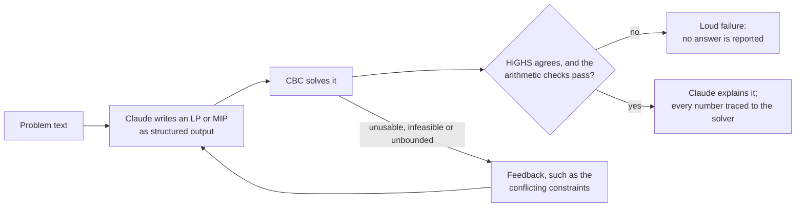

# opt-agent

**Plain-English operations problems in, verified optimal plans out.** Claude writes a word
problem ("how many litres of each paint should we make?") as a linear or integer program, a
real solver (CBC) solves it, a second solver (HiGHS) and plain arithmetic check the answer,
and only a verified answer gets explained, in Claude's words but with the solver's numbers.
Most of the project is the evaluation: two studies, pre-registered and frozen before any
test problem was opened, that ask whether a solver in the loop helps at all, and how often a
wrong answer gets through every check. Every reported number rebuilds from committed cached
replies, with no API key.


*The demo in examples mode: no API key, and every Claude reply replayed from the committed
cache.*

## Results

Both studies used Claude Haiku 5.5. Every number in this README comes from
[`results/eval.json`](results/eval.json) or [`results/followup.json`](results/followup.json),
and a test checks it.

### NL4Opt: saturated, and every failure silent

The NL4Opt test split, 274 problems, three conditions:

| condition | accuracy (95% Wilson) | silent / loud failures |
|---|---|---|
| no-solver baseline (Claude answers directly) | 96.4% (93.4–98.0%) | 10 / 0 |
| single-shot (formulate, solve, verify) | 96.4% (93.4–98.0%) | 10 / 0 |
| self-correction (revise on a failed attempt) | 96.4% (93.4–98.0%) | 10 / 0 |

All three got 264 of 274 right, and none of the 6 pre-registered McNemar tests comes close
(every p = 1). The baseline, with no solver at all, matched the solver conditions, so NL4Opt
is too easy to show what a solver adds. And all 10 failures per condition were silent: CBC
and HiGHS agreed and every check passed, on a model that misread the text. Full write-up:
[`docs/EVALUATION.md`](docs/EVALUATION.md).

### Harder problems: a small gain, still mostly silent failures

A follow-up on 128 harder problems (LLM4OR's cleaned ComplexLP and IndustryOR), 3 samples
each, in four conditions. The primary analysis uses the 121 problems no one had seen before
the split.

| condition | mean score (95% CI) |
|---|---|
| no-solver baseline | 75.8% (68.9–82.4%) |
| single-shot | 82.1% (75.8–87.9%) |
| self-correction | 82.4% (76.0–88.2%) |
| checklist revision (one revision on a formulation checklist's flags) | 82.6% (76.6–88.2%) |

- **H2, single-shot minus the baseline: +6.3 pp, detected** on the pre-registered primary
  test (sign-flip, Holm p 0.0445). Two caveats: the secondary McNemar test on majority votes
  isn't significant (Holm p 0.24), and 1.38 pp of the difference comes from 8 baseline
  replies cut off at max_tokens.
- **H1, checklist revision minus single-shot: inconclusive.** +0.6 pp (95% CI -1.7 to
  3.0 pp): no difference larger than 4 pp, and nothing stronger.
- **Failures are mostly silent.** Silent / loud, over every sample answer: baseline 83 / 11,
  single-shot 62 / 4, self-correction 65 / 0, checklist revision 59 / 4.

Full write-up: [`docs/followup/RESULTS.md`](docs/followup/RESULTS.md).

## Limitations

- **Verification can't see a wrong model.** It proves the solution of Claude's formulation,
  not that the formulation says what the text says, which is why nearly every failure above
  is silent. The report-only flags (a direct estimate, a formulation checklist) are attempts
  at that signal; revising on the checklist's flags didn't measurably help (H1).
- **One model, one sign-flip test.** Every number is Claude Haiku 5.5's. H2 is detected by
  the pre-registered primary test only, and part of it comes from baseline replies that ran
  out of tokens.
- **The answer keys aren't perfect.** On NL4Opt, two LLM judges labeled 6 of the 8 shared
  failures answer-key errors (exploratory, post hoc). In the follow-up, 15 problems meet the
  pre-registered dispute trigger, and the planned key check wasn't performed (a recorded
  deviation), so whether any of those are key errors is unknown.
- **The judges are LLMs,** and the judge of record is Claude, the agent's own family.
- **A bug in the NL4Opt key's integrality rule** read some countable products as continuous,
  which cost 4 answers per condition; it's recorded as a deviation, and the result of record
  stands as pre-registered.
- **The demo is local only.** Its live mode is guarded (one solve at a time, a length limit,
  a token cap per reply, a dollar cap), not hardened for a public endpoint.

## Try the demo

With Docker, in examples mode (no key; nothing is sent anywhere):

```bash
docker build -t opt-agent .
docker run --rm -p 8000:8000 opt-agent
```

Open `http://localhost:8000` and pick an example. Examples mode replays the four example
problems' cached replies; any other text needs live mode and your own Anthropic key in `.env`
(the image never contains it):

```bash
docker run --rm -p 8000:8000 --env-file .env -e OPT_AGENT_LIVE=1 opt-agent
```

Without Docker: `pip install -r requirements.lock && pip install --no-deps -e .`, then
`python -m opt_agent.demo` (add `OPT_AGENT_LIVE=1` in front for live mode).

## Reproduce every number

```bash
python scripts/fetch_llm4or.py   # LLM4OR's cleaned benchmarks: pinned commit, checked hashes
python scripts/reproduce.py      # no API key; a few minutes
```

`reproduce.py` runs each study's frozen code from its git tag (`m6-freeze`,
`followup-freeze`), not the current code. It replays every committed answer from the run's
cached replies, with a client that refuses any request, and checks it against the committed
results; then it rebuilds both reports and both results files and checks them byte for byte.
CI runs it on every push, along with the tests and the demo image.

## How it works



- **Formulate:** Claude returns JSON in the project's LP/MIP schema (structured output),
  validated for meaning, not just shape.
- **Verify, don't trust:** CBC and HiGHS must agree; plain arithmetic checks every
  constraint and, for an LP, a duality certificate; "unbounded" needs a certified ray.
- **Self-correct:** an unusable reply or an infeasible or unbounded model goes back to
  Claude with specific feedback, and revisions that quietly loosen the problem are flagged.
- **Explain** only verified answers, and flag any number in the explanation that isn't a
  solver fact or an input.

The details, including the solver bugs these checks caught, are in
[`docs/DESIGN.md`](docs/DESIGN.md).

## How this differs from OptiMUS, ORLM and Chain-of-Experts

OptiMUS (ICML 2024) and Chain-of-Experts (ICLR 2024) are multi-agent LLM systems for
formulating optimization problems, and ORLM fine-tunes open models on synthetic modeling
data (it's also where IndustryOR comes from). They aim to raise benchmark accuracy.
opt-agent is deliberately small and asks a narrower question: does a solver in the loop
help, and can you tell when an answer is wrong? Its contribution is the evaluation: frozen
pre-registrations, two-solver verification, a silent-versus-loud failure split, and results
anyone can rebuild without a key.

## More detail

- [`docs/EVALUATION.md`](docs/EVALUATION.md) and
  [`docs/followup/RESULTS.md`](docs/followup/RESULTS.md): both studies in full.
- Pre-registrations: [NL4Opt](docs/PREREGISTRATION.md) (amendments in
  [`docs/amendments/`](docs/amendments/)) and the [follow-up](docs/FOLLOWUP_PREREGISTRATION.md)
  (deviations in [`docs/followup/DEVIATIONS.md`](docs/followup/DEVIATIONS.md)).
- [`docs/DESIGN.md`](docs/DESIGN.md): the solver checks, the agent, the NL4Opt answer key,
  and the project structure.
- [`docs/audit/2026-11-review.md`](docs/audit/2026-11-review.md): a full audit of the project.
- [`DATA_NOTICE.md`](DATA_NOTICE.md): the benchmarks' licenses and attribution.

## Development

```bash
python3 -m venv .venv && source .venv/bin/activate
pip install -r requirements.lock && pip install --no-deps -e .
pytest                                  # no key needed: tests use a fake Claude client
ruff check . && ruff format --check .
```

The agent's command line (`python -m opt_agent.agent "..."`) and the live tests need a key:
export `ANTHROPIC_API_KEY`, or set `OPT_AGENT_LIVE=1` to use the one in `.env`. Without one
of them, nothing can spend.

## License and sources

The code is MIT ([`LICENSE`](LICENSE)). The benchmarks are NL4Opt (the first study) and
LLM4OR's cleaned versions of Mamo's ComplexLP and ORLM's IndustryOR (the follow-up). The run
records under `runs/` hold their problem text and answers, which keep their own licenses,
including CC BY-SA 4.0 (ComplexLP) and CC BY-NC 4.0 (IndustryOR): see
[`DATA_NOTICE.md`](DATA_NOTICE.md).
