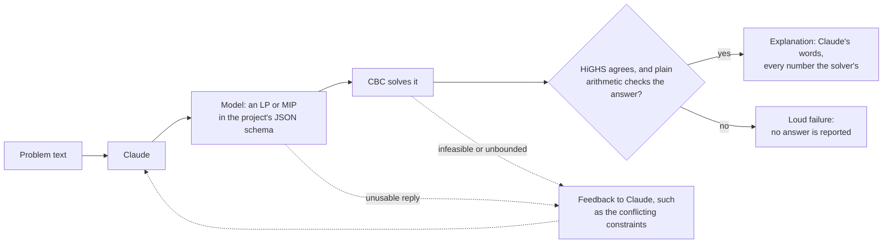

# opt-agent

[](https://github.com/Max25R/opt-agent/actions/workflows/ci.yml)
[](https://github.com/Max25R/opt-agent/actions/workflows/ci.yml)
[](pyproject.toml)

**Plain-English operations problems in, solver-verified plans out, and an honest count of
how often they're still wrong.** Claude writes a word problem ("how many litres of each paint
should we make?") as a linear or integer program, a real solver (CBC) solves it, a second
solver (HiGHS) and plain arithmetic check the answer, and only a verified answer gets
explained, in Claude's words but with the solver's numbers. Most of the project is the
evaluation: two studies, each pre-registered and frozen before its test run, that ask whether
a solver in the loop helps at all, and how often a wrong answer gets through every check.

| accuracy (Claude Haiku 5.5) | no-solver baseline | single-shot | self-correction | checklist revision |
|---|---|---|---|---|
| NL4Opt, 274 problems | 96.4% | 96.4% | 96.4% | not run |
| harder problems, 121 (3 samples each) | 75.8% | 82.1% | 82.4% | 82.6% |

On NL4Opt a solver adds nothing: Claude answering directly does as well. On the harder
problems, solving Claude's model beats answering directly by +6.3 pp (the pre-registered
test, Holm p 0.0445), and revising on a formulation checklist adds nothing detectable. In
every condition most wrong answers are *silent*: every check passes, so nothing warns you.
Every reported number rebuilds from the committed runs with no API key, after fetching the
follow-up's public benchmark data ([how](#reproduce-every-number)).


*The demo in examples mode: no API key, and every Claude reply replayed from the committed
cache.*

## Results

Both studies used Claude Haiku 5.5. Every number in this README comes from
[`results/eval.json`](results/eval.json) or [`results/followup.json`](results/followup.json),
and a test checks it.

### NL4Opt: saturated, and every failure silent

The NL4Opt test split, 274 problems, three conditions:

| condition | accuracy (95% Wilson) | silent / loud failures |
|---|---|---|
| no-solver baseline (Claude answers directly) | 96.4% (93.4–98.0%) | 10 / 0 |
| single-shot (formulate, solve, verify) | 96.4% (93.4–98.0%) | 10 / 0 |
| self-correction (revise on a failed attempt) | 96.4% (93.4–98.0%) | 10 / 0 |

All three got 264 of 274 right, and none of the 6 pre-registered McNemar tests comes close
(every p = 1). The baseline, with no solver at all, matched the solver conditions, so NL4Opt
is too easy to show what a solver adds. All 10 failures per condition were silent, a wrong
answer with no warning (in the solver conditions, CBC and HiGHS agreed and every check
passed), though most of the shared ones may be answer-key errors (see Limitations). Two
other pre-registered rows: lenient scoring (integrality not graded) gives both solver
conditions 266/274 and the baseline 264/274 (exploratory McNemar tests, every p = 1), and
leaving out the 8 disputed reviews gives 260/266 in every condition. Full write-up:
[`docs/EVALUATION.md`](docs/EVALUATION.md).

### Harder problems: a small gain, still mostly silent failures

A follow-up on 128 harder problems (LLM4OR's cleaned ComplexLP and IndustryOR), 3 samples
each, in four conditions. The primary analysis uses 121 of them, leaving out the 7 seen
before the split.

| condition | mean score (95% CI) |
|---|---|
| no-solver baseline | 75.8% (68.9–82.4%) |
| single-shot | 82.1% (75.8–87.9%) |
| self-correction | 82.4% (76.0–88.2%) |
| checklist revision (one revision on a formulation checklist's flags) | 82.6% (76.6–88.2%) |

- **H2, single-shot minus the baseline: +6.3 pp, detected** on the pre-registered primary
  test (sign-flip, Holm p 0.0445). Two caveats: the secondary McNemar test on majority votes
  isn't significant (Holm p 0.24), and 1.38 pp of the difference comes from 8 baseline
  replies cut off at max_tokens.
- **H1, checklist revision minus single-shot: inconclusive.** +0.6 pp (95% CI -1.7 to
  3.0 pp): no difference larger than 4 pp, and nothing stronger.
- **Failures are mostly silent.** Silent / loud, over every sample answer on all 128
  problems: baseline 83 / 11, single-shot 62 / 4, self-correction 65 / 0, checklist revision
  59 / 4.

Full write-up: [`docs/followup/RESULTS.md`](docs/followup/RESULTS.md).

## Limitations

- **Verification can't see a wrong model.** It checks the solution of Claude's formulation
  (for an LP it proves optimality with a certificate; for a MIP, two solvers agree), not that
  the formulation says what the text says, which is why nearly every failure above is silent.
  The report-only flags (a direct estimate, a formulation checklist) are attempts at that
  signal; revising on the checklist's flags didn't measurably help (H1).
- **The cross-check never fired in either study.** No loud failure came from the solvers
  disagreeing or a check failing: NL4Opt had no loud failures at all, and every loud failure
  in the follow-up was an unusable or cut-off reply. The checks did catch real solver bugs,
  in the property tests ([`docs/DESIGN.md`](docs/DESIGN.md)).
- **Self-correction's 0 loud failures aren't a gain.** In the follow-up it revised
  single-shot's 4 unusable replies: 1 became right, and 3 became wrong answers with no
  warning. (The silent / loud counts cover all 128 problems; the scores, 121.)
- **The explanation was never evaluated.** Every study run skipped it and scored answers
  only, so "every number traced to the solver" is what the code checks, not a measured
  result.
- **One model, one sign-flip test.** Every number is Claude Haiku 5.5's. H2 is detected by
  the pre-registered primary test only, and part of it comes from baseline replies that ran
  out of tokens.
- **The answer keys aren't perfect, and their errors cut both ways.** On NL4Opt, two LLM
  judges labeled 6 of the 8 shared failures answer-key errors (exploratory, post hoc). Against
  LLM4OR's independently cleaned NL4Opt key, every condition scores 185/210 (88.1%) on the
  problems both keys cover, against 205 or 206 of the same 210 on ours, mostly where the two
  keys differ ([Amendment 5](docs/amendments/amendment-5.md), exploratory). In the follow-up,
  15 problems meet the pre-registered dispute trigger, and the planned key check wasn't
  performed (a recorded deviation), so whether any of those are key errors is unknown.
- **No person checked the test results.** Every "hand check" (blind grading of the models,
  labeling each failure's cause, and checking the answer key's labels and reviews) was done
  by LLM judges, and the judge of record is Claude, the agent's own family. Claude also wrote
  the key's reviews and most of its integrality labels.
- **The benchmarks are public,** so Claude may have seen them in training. On NL4Opt, 240
  problems with their numbers changed kept their accuracy (96.7–97.1%), and no answer matched
  the original problem's, which argues against memorized answers; the follow-up has no such
  check.
- **A bug in the NL4Opt key's integrality rule** read some countable products as continuous,
  which cost 4 answers per condition; it's recorded as a deviation, and the result of record
  stands as pre-registered.
- **The demo is local only.** Its live mode is guarded (one solve at a time, a length limit,
  a token cap per reply, a dollar cap), not hardened for a public endpoint.

## Setup

Python 3.12 or newer (the studies ran on Python 3.13), in a virtual environment:

```bash
python3 -m venv .venv && source .venv/bin/activate
pip install -r requirements.lock && pip install --no-deps -e .   # the locked versions
```

## Try the demo

With Docker, in examples mode (no key; nothing is sent anywhere):

```bash
docker build -t opt-agent .
docker run --rm -p 8000:8000 opt-agent
```

Open `http://localhost:8000` and pick an example. Examples mode replays the four example
problems' cached replies; any other text needs live mode and your own Anthropic key in `.env`
(the image never contains it):

```bash
docker run --rm -p 8000:8000 --env-file .env -e OPT_AGENT_LIVE=1 opt-agent
```

Live mode's dollar cap (`OPT_AGENT_DEMO_CAP_USD`) is counted in a spend ledger inside the
container, so every `docker run --rm` starts again from zero: the cap holds per container,
not in all. A volume at `/app/logs` (`-v opt-agent-logs:/app/logs`) keeps one ledger across
containers.

Without Docker, after [Setup](#setup): `python -m opt_agent.demo` (add `OPT_AGENT_LIVE=1` in
front for live mode).

## Reproduce every number

After [Setup](#setup):

```bash
python scripts/fetch_llm4or.py   # LLM4OR's cleaned benchmarks: pinned commit, checked hashes
python scripts/reproduce.py      # no API key; a few minutes
```

`reproduce.py` runs each study's frozen code from its git tag (`m6-freeze`,
`followup-freeze`), not the current code. It replays every committed answer from the run's
cached replies, with a client that refuses any request, and checks it against the committed
results; then it rebuilds both reports and both results files and checks them byte for byte.
CI runs it on every push, on macOS arm64 like the original runs, along with the tests and the
demo image. (On Linux, one follow-up model has a second optimal solution that CBC picks
instead, which changes one pair's revision path but not its answer.) Replay can't redo two
things: the LLM judges' labels come from chat sessions, committed as the sheets they filled
in, and a new run would give new answers, since Claude samples at temperature 1.
To redraw the pictures too (the screenshot and the IE 2310 figures), install the optional
tools with `pip install -r requirements-docs.lock -c requirements.lock` and
`python -m playwright install --only-shell chromium`.

## How it works



A verified answer can still be wrong: the checks are about Claude's model, not whether the
model says what the text says (a *silent* failure).

- **Formulate:** Claude returns JSON in the project's LP/MIP schema (structured output),
  validated for meaning, not just shape.
- **Verify, don't trust:** CBC and HiGHS must agree; plain arithmetic checks every
  constraint and, for an LP, a duality certificate; "unbounded" needs a certified ray.
- **Self-correct:** an unusable reply or an infeasible or unbounded model goes back to
  Claude with specific feedback, and revisions that quietly loosen the problem are flagged.
- **Explain** only verified answers, and flag any number in the explanation that isn't a
  solver fact or an input (the demo shows it; the studies didn't evaluate it).

The details, including the solver bugs these checks caught, are in
[`docs/DESIGN.md`](docs/DESIGN.md).

## How this differs from OptiMUS, ORLM and Chain-of-Experts

OptiMUS (ICML 2024) and Chain-of-Experts (ICLR 2024) are multi-agent LLM systems for
formulating optimization problems, and ORLM fine-tunes open models on synthetic modeling
data (it's also where IndustryOR comes from). They aim to raise benchmark accuracy.
opt-agent is deliberately small and asks a narrower question: does a solver in the loop
help, and can you tell when an answer is wrong? Its contribution is the evaluation: frozen
pre-registrations, two-solver verification, a silent-versus-loud failure split, and results
anyone can rebuild without a key.

## More detail

- [`docs/EVALUATION.md`](docs/EVALUATION.md) and
  [`docs/followup/RESULTS.md`](docs/followup/RESULTS.md): both studies in full.
- Pre-registrations: [NL4Opt](docs/PREREGISTRATION.md) (amendments in
  [`docs/amendments/`](docs/amendments/)) and the [follow-up](docs/FOLLOWUP_PREREGISTRATION.md)
  (deviations in [`docs/followup/DEVIATIONS.md`](docs/followup/DEVIATIONS.md)).
- [`docs/DESIGN.md`](docs/DESIGN.md): the solver checks, the agent, the NL4Opt answer key,
  and the project structure.
- [`docs/adr/`](docs/adr/README.md): why it's built this way: the options weighed and their costs.
- [`docs/analysis/failure_types.md`](docs/analysis/failure_types.md): why the wrong answers
  were wrong, classified by Claude (an LLM), not a person; exploratory and post hoc. And
  [`docs/analysis/silent_detector.md`](docs/analysis/silent_detector.md): a rule for spotting
  silent failures, committed before its one run, and how weak it is.
- [`docs/audit/2026-11-review.md`](docs/audit/2026-11-review.md) and
  [`docs/audit/2026-11-final-review.md`](docs/audit/2026-11-final-review.md): two audits of
  the project, and what was fixed.
- [`docs/HISTORY.md`](docs/HISTORY.md): how the project got here, milestone by milestone.
- [`DATA_NOTICE.md`](DATA_NOTICE.md): the benchmarks' licenses and attribution.

## Development

After [Setup](#setup):

```bash
pytest                                  # no key needed: tests use a fake Claude client
ruff check . && ruff format --check .
pip install -r requirements-checks.lock -c requirements.lock   # mypy and coverage
python -m mypy                          # src/, with the settings in pyproject.toml
python -m coverage run -m pytest && python -m coverage report
```

mypy is the plain (not `--strict`) check; the line-by-line exceptions say why in a comment.
The coverage badge is the whole suite's figure with all the data, as CI's reproduce job
measures it (`scripts/coverage_badge.py`, which fails CI if the badge drifts by more than a
point); without the data, the tests that need it skip and the figure reads lower.

The agent's command line (`python -m opt_agent.agent "..."`) needs a key: export
`ANTHROPIC_API_KEY`, or set `OPT_AGENT_LIVE=1` to use the one in `.env`. Without one of them,
nothing can spend, and its paid calls stop at a dollar cap (`--cap`), counted across runs in
`logs/spend/agent.jsonl`. The live tests (`pytest -m live`) call the real API, so they run
only with `OPT_AGENT_LIVE=1`, whatever `-m` says.

## How this was built

Built with Claude Code as the pair programmer, which is why Claude is a co-author on most
commits and why the repository has a `CLAUDE.md` (its working instructions). I set the design
and research decisions, reviewed the work and made the calls.

## License and sources

The code is MIT ([`LICENSE`](LICENSE)). The benchmarks are NL4Opt (the first study) and
LLM4OR's cleaned versions of Mamo's ComplexLP and ORLM's IndustryOR (the follow-up). The run
records under `runs/` hold their problem text and answers, which keep their own licenses,
including CC BY-SA 4.0 (ComplexLP) and CC BY-NC 4.0 (IndustryOR): see
[`DATA_NOTICE.md`](DATA_NOTICE.md).
