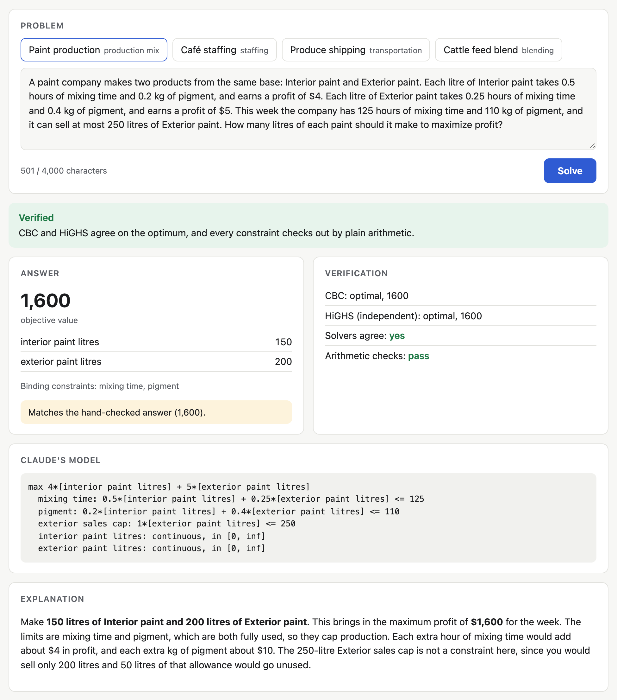
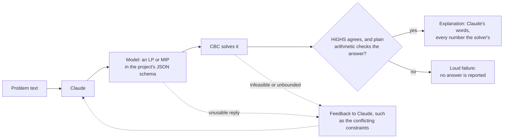

# opt-agent

[](https://github.com/Max25R/opt-agent/actions/workflows/ci.yml)
[](https://github.com/Max25R/opt-agent/actions/workflows/ci.yml)
[](pyproject.toml)

**[Try the demo in your browser](https://max25r.github.io/opt-agent/)**: no install, no API
key; a static copy of the examples page, solved by CI from Claude's committed replies.

**Plain-English operations problems in, solver-verified plans out, and an honest count of
how often they're still wrong.**

- Claude writes a word problem as a linear or integer program; a solver (CBC) solves it, a
  second solver (HiGHS) and plain arithmetic check it, and Claude explains it with the solver's
  numbers.
- On NL4Opt every condition scored 96.4%, even with no solver; on 121 harder problems,
  solving Claude's model beat answering directly by +6.3 pp (95% CI 1.4–11.6).
- In every condition most wrong answers are *silent*: every check passes, so nothing warns you.


<!-- cost and latency: results/headline.json -->
| per answer | NL4Opt: cost | median | p90 | harder problems: cost | median | p90 |
|---|---:|---:|---:|---:|---:|---:|
| no-solver baseline | $0.00045 | 3.8 s | 7.2 s | $0.0016 | 9.7 s | 32.6 s |
| single-shot | $0.00055 | 3.6 s | 5.7 s | $0.0021 | 11.8 s | 25.6 s |
| self-correction | $0.00061 | 3.7 s | 6.9 s | $0.0021 | 11.9 s | 25.6 s |
| checklist revision | not run | | | $0.0054 | 26.8 s | 70.2 s |

*From the test runs' own logs ([`scripts/headline.py`](scripts/headline.py)): the cost of
every call an answer used, at Claude Haiku 5.5's prices, and its latency (API plus solver time,
without retry waits), over 274 answers per condition on NL4Opt and 384 on the harder problems
(128 problems, 3 samples each).*
<!-- end of cost and latency -->

Most of the project is the evaluation: three studies, each pre-registered and frozen before
its test run, asking whether a solver in the loop helps at all, how often a wrong answer gets
through every check, and whether disagreement between samples can flag one (it can:
[below](#resampling-the-disagreement-flag-confirmed)).

| accuracy (Claude Haiku 5.5) | no-solver baseline | single-shot | self-correction | checklist revision |
|---|---|---|---|---|
| NL4Opt, 274 problems | 96.4% | 96.4% | 96.4% | not run |
| harder problems, 121 (3 samples each) | 75.8% | 82.1% | 82.4% | 82.6% |

The +6.3 pp is the pre-registered test (Holm p 0.0445), and revising on a formulation checklist
adds nothing detectable. Every reported number rebuilds from the committed runs with no API
key, after fetching the follow-up's public benchmark data ([how](#reproduce-every-number)).



*The demo in examples mode: no API key, and every Claude reply replayed from the committed
cache.*

## Results

Every study used Claude Haiku 5.5. Every number in this README comes from
[`results/eval.json`](results/eval.json), [`results/followup.json`](results/followup.json) or
[`results/resampling.json`](results/resampling.json) (the cost and latency table at the top:
[`results/headline.json`](results/headline.json), computed from the runs' logs), and a test
checks it. A *silent* failure is a wrong answer that passed every check; a *loud*
one is no answer at all. "pp" is percentage points; Holm adjusts a p-value for testing more
than one hypothesis; the sign-flip and McNemar tests compare two conditions on the same
problems.

### NL4Opt: saturated, and every failure silent

The NL4Opt test split's 274 scorable problems (the rest fail the answer key's checks or were
used while building the agent: [counts](data/nl4opt/ground_truth/REPORT.md)), three
conditions:

| condition | accuracy (95% Wilson) | silent / loud failures |
|---|---|---|
| no-solver baseline (Claude answers directly) | 96.4% (93.4–98.0%) | 10 / 0 |
| single-shot (formulate, solve, verify) | 96.4% (93.4–98.0%) | 10 / 0 |
| self-correction (revise on a failed attempt) | 96.4% (93.4–98.0%) | 10 / 0 |

All three got 264 of 274 right, and none of the 6 pre-registered McNemar tests comes close
(every p = 1): with no solver at all, the baseline did as well, so NL4Opt is too easy to show
what a solver adds. All 10 failures per condition were silent (in the solver conditions, CBC
and HiGHS agreed and every check passed); of the 8 problems all three conditions got wrong,
two LLM judges flagged 6 as answer-key errors, not verified by a person (see Limitations).
Two other pre-registered rows: lenient scoring (integrality not graded) gives both solver
conditions 266/274 and the baseline 264/274 (exploratory McNemar tests, every p = 1), and
leaving out the 8 disputed reviews gives 260/266 in every condition. Full write-up:
[`docs/EVALUATION.md`](docs/EVALUATION.md).

### Harder problems: a small gain, still mostly silent failures

A follow-up on 128 harder problems (LLM4OR's cleaned ComplexLP and IndustryOR), 3 samples
each, in four conditions. The primary analysis uses 121 of them, leaving out the 7 seen
before the split.

| condition | mean score (95% CI) |
|---|---|
| no-solver baseline | 75.8% (68.9–82.4%) |
| single-shot | 82.1% (75.8–87.9%) |
| self-correction | 82.4% (76.0–88.2%) |
| checklist revision (one revision on a formulation checklist's flags) | 82.6% (76.6–88.2%) |

- **H2, single-shot minus the baseline: +6.3 pp, detected** on the pre-registered primary
  test (sign-flip, Holm p 0.0445). Two caveats: the secondary McNemar test on majority votes
  isn't significant (Holm p 0.24), and 1.38 pp of the difference comes from 8 baseline
  replies cut off at max_tokens.
- **H1, checklist revision minus single-shot: inconclusive.** +0.6 pp (95% CI -1.7 to
  3.0 pp). The pre-registered reading of that interval is "no difference larger than 4 pp"
  (the smallest whole number of points it fits inside), and nothing stronger.
- **Failures are mostly silent.** Silent / loud, over every sample answer on all 128
  problems: baseline 83 / 11, single-shot 62 / 4, self-correction 65 / 0, checklist revision
  59 / 4.

Full write-up: [`docs/followup/RESULTS.md`](docs/followup/RESULTS.md).

### Resampling: the disagreement flag, confirmed

A third pre-registered study ([pre-registration](docs/RESAMPLING_PREREGISTRATION.md)) tested
the exploratory disagreement detector (under Limitations) on fresh samples of the 121
unexposed harder problems: an answer was flagged when five new single-shot samples didn't all
agree or a new no-solver answer differed. **It's confirmed** (R1 supported, one-sided Fisher
p 2.3e-6): of the 119 verified answers, the 38 flagged were silent failures 52.6% of the time
(95% Wilson 37.3–67.5%) against a 24.4% base rate, and the flag caught 20 of the 29 silent
failures (69.0%), at six calls per problem instead of one. It's a warning, not a fix:
withholding flagged answers would make those 20 failures loud but lose 18 right answers, and
the majority of the five samples was right more often than one sample (101 of 121 problems
against 90; secondary, exact McNemar p 0.001).

Full write-up, with its one deviation (it changes no number):
[`docs/resampling/RESULTS.md`](docs/resampling/RESULTS.md).

## Limitations

- **Verification can't see a wrong model.** It checks the solution of Claude's formulation
  (for an LP it proves optimality with a certificate; for a MIP, two solvers agree), not that
  the formulation says what the text says, which is why nearly every failure above is silent.
  The report-only flags (a direct estimate, a formulation checklist) are attempts at that
  signal; revising on the checklist's flags didn't measurably help (H1).
- **Exploratory: disagreement between attempts as a warning.** A detector whose rules were
  fixed before its one run flagged single-shot answers that the problem's other samples, the
  checklist revision or the no-solver baseline contradicted. On the follow-up, 38.6% of the
  answers it flagged were silent failures, against a 16.3% base rate, and it caught 62.9% of
  them (number coverage, an earlier detector: 19.5%). A problem's three samples are
  clustered, so its confidence intervals are too narrow, and none of this is a result of
  record ([details](docs/analysis/disagreement_detector.md)). The pre-registered resampling
  study then confirmed the pattern on fresh samples
  ([Results](#resampling-the-disagreement-flag-confirmed)).
- **The cross-check never fired in either study.** No loud failure came from the solvers
  disagreeing or a check failing: NL4Opt had no loud failures at all, and every loud failure
  in the follow-up was an unusable or cut-off reply. The checks did catch real solver bugs,
  in the property tests ([`docs/DESIGN.md`](docs/DESIGN.md)).
- **Self-correction's 0 loud failures aren't a gain.** In the follow-up it revised
  single-shot's 4 unusable replies: 1 became right, and 3 became wrong answers with no
  warning. (The silent / loud counts cover all 128 problems; the scores, 121.)
- **The explanation was never evaluated in a study.** Every study run skipped it.
- **Exploratory: the explanation checker, on dev.** By an LLM's labels (Claude's, not a
  person's), Claude Haiku 5.5's 88 dev explanations used no wrong number, so the checker had
  nothing to catch (its 5 flags were correctly computed numbers), but 22 of them (25.0%)
  made a false claim with every number correct, which no number check can see: mostly that a
  constraint with slack doesn't limit an integer program's answer, when dropping it changes
  the optimum ([details](docs/analysis/explanation_checker.md)). Since then the explainer gets
  the solver's own test of what limits an integer program
  ([an ADR](docs/adr/0009-what-limits-an-integer-program.md)). Explaining the same dev answers
  again with it, the integer programs' explanations with such a false claim went 13 → 4 by the
  same rule (a post hoc note, Claude's reading: those 4 are the rule naming the wrong
  constraint), and explanations with any false claim went 22 → 11 by the explanation checker's
  own blind labels (exploratory, dev only, Claude's labels:
  [details](docs/analysis/limits_claims.md)).
- **One model.** Every number is Claude Haiku 5.5's, and H2 rests on the primary test
  alone (its caveats are under Results).
- **The answer keys aren't perfect, and their errors cut both ways.** On NL4Opt, two LLM
  judges flagged 6 of the 8 shared failures as answer-key errors, not verified by a person
  (exploratory, post hoc). A bug in that key's integrality rule read some countable products
  as continuous, which cost 4 answers per condition (a recorded deviation; the result of
  record stands as pre-registered). Against LLM4OR's independently cleaned NL4Opt key, every
  condition scores 185/210 (88.1%) on the problems both keys cover, against 205 or 206 of the
  same 210 on ours, mostly where the two keys differ
  ([Amendment 5](docs/amendments/amendment-5.md), exploratory). In the follow-up, 15 problems
  meet the pre-registered dispute trigger, and the planned key check wasn't performed (a
  recorded deviation), so whether any of those are key errors is unknown.
- **No person checked the test results.** Every "hand check" (blind grading of the models,
  labeling each failure's cause, and checking the answer key's labels and reviews) was done
  by LLM judges, and the judge of record is Claude, the agent's own family. Claude also wrote
  the key's reviews and most of its integrality labels.
- **The benchmarks are public,** so Claude may have seen them in training. On NL4Opt, 240
  problems with their numbers changed kept their accuracy (96.7–97.1%), and no answer matched
  the original problem's, which argues against memorized answers; the follow-up has no such
  check.
- **The live demo is local only.** The page online replays the examples and nothing else;
  live mode is guarded (one solve at a time, a length limit, a token cap per reply, a dollar
  cap), not hardened for a public endpoint.

## Setup

Python 3.12 or newer (the studies ran on Python 3.13), in a virtual environment:

```bash
python3 -m venv .venv && source .venv/bin/activate
pip install -r requirements.lock && pip install --no-deps -e .   # the locked versions
```

## Try the demo

The quickest way is [the static page](https://max25r.github.io/opt-agent/), with nothing to
install: CI builds it by running the demo app on the examples' committed replies, both
solvers included (`scripts/static_demo.py`). To run the app itself, with Docker, in examples
mode (no key; nothing is sent anywhere):

```bash
docker build -t opt-agent .
docker run --rm -p 8000:8000 opt-agent
```

Open `http://localhost:8000` and pick an example. Examples mode replays the example
problems' cached replies; any other text needs live mode and your own Anthropic key in `.env`
(the image never contains it). Each verified answer also gets the
[resampling study](#resampling-the-disagreement-flag-confirmed)'s disagreement badge,
"samples disagree — lower confidence" or "samples agree", shown with the precision and recall
that study measured. Four examples are written for this project and all agree; the fifth,
"Freight cars", is benchmark text chosen to show the warning: a problem from the resampling
study whose answer passed every check and was wrong, replayed from that run's own replies.

```bash
docker run --rm -p 8000:8000 --env-file .env -e OPT_AGENT_LIVE=1 opt-agent
```

Live mode stops at a dollar cap (`OPT_AGENT_DEMO_CAP_USD`), counted in a ledger inside the
container, so each `docker run --rm` starts again from zero; a volume at `/app/logs`
(`-v opt-agent-logs:/app/logs`) keeps one ledger across containers.

Without Docker, after [Setup](#setup): `python -m opt_agent.demo` (add `OPT_AGENT_LIVE=1` in
front for live mode).

## Reproduce every number

After [Setup](#setup):

```bash
python scripts/fetch_llm4or.py   # LLM4OR's cleaned benchmarks: pinned commit, checked hashes
python scripts/reproduce.py      # no API key; a few minutes
```

`reproduce.py` runs each study's frozen code from its git tag (`m6-freeze`,
`followup-freeze`, `resampling-freeze`), not the current code. It replays every committed
answer from the run's cached replies, with a client that refuses any request, and checks it
against the committed results; then it rebuilds the reports and the three results files and
checks them byte for byte.
CI runs it on every push, on macOS arm64 like the original runs (on Linux, CBC picks another
optimal solution for one follow-up model, which changes one pair's revision path but not its
answer). Two things can't be replayed: the LLM judges' labels came from chat sessions and are
committed as the sheets they filled in, and a new run would give new answers, since Claude
samples at temperature 1.

The pictures (the screenshot, and the figures of [`docs/ie2310/`](docs/ie2310/README.md), the
agent's side of the IE 2310 course project) need the optional tools:
`pip install -r requirements-docs.lock -c requirements.lock` and
`python -m playwright install --only-shell chromium`.

## How it works



A verified answer can still be wrong: the checks are about Claude's model, not whether the
model says what the text says (a *silent* failure).

- **Formulate:** Claude returns JSON in the project's LP/MIP schema (structured output),
  validated for meaning, not just shape.
- **Verify, don't trust:** CBC and HiGHS must agree; plain arithmetic checks every
  constraint and, for an LP, a duality certificate; "unbounded" needs a certified ray.
- **Self-correct:** an unusable reply or an infeasible or unbounded model goes back to
  Claude with specific feedback, and revisions that quietly loosen the problem are flagged.
- **Explain** only verified answers, and flag any number in the explanation that isn't a
  solver fact or an input (the demo shows it; only an exploratory check on dev, by an
  LLM, has evaluated it: see Limitations).

The details, including the solver bugs these checks caught, are in
[`docs/DESIGN.md`](docs/DESIGN.md), which opens with
[a ten-minute tour of the code](docs/DESIGN.md#read-the-code-in-10-minutes).

## Use it as an Agent Skill

[`skills/opt-agent/`](skills/opt-agent/SKILL.md) packs the workflow for any Claude agent:
formulate with an integrality choice per variable, solve with CBC, verify with HiGHS and
plain arithmetic, explain with the solver's numbers only, and warn that a wrong answer can
pass every check. Its two scripts need only PuLP and SciPy. Copy the folder into
`~/.claude/skills/`, or install it from this repository, which is also a free plugin
marketplace:

```bash
claude plugin marketplace add Max25R/opt-agent
claude plugin install opt-agent@max25r-opt-agent
```

## How this differs from OptiMUS, ORLM and Chain-of-Experts

OptiMUS (ICML 2024) and Chain-of-Experts (ICLR 2024) are multi-agent LLM systems for
formulating optimization problems, and ORLM fine-tunes open models on synthetic modeling
data (it's also where IndustryOR comes from). They aim to raise benchmark accuracy.
opt-agent is deliberately small and asks a narrower question: does a solver in the loop
help, and can you tell when an answer is wrong? Its contribution is the evaluation: frozen
pre-registrations, two-solver verification, a silent-versus-loud failure split, and results
anyone can rebuild without a key.

## More detail

- [`docs/EVALUATION.md`](docs/EVALUATION.md), [`docs/followup/RESULTS.md`](docs/followup/RESULTS.md)
  and [`docs/resampling/RESULTS.md`](docs/resampling/RESULTS.md): the three studies in full.
- Pre-registrations: [NL4Opt](docs/PREREGISTRATION.md) (amendments in
  [`docs/amendments/`](docs/amendments/)), the [follow-up](docs/FOLLOWUP_PREREGISTRATION.md)
  (deviations in [`docs/followup/DEVIATIONS.md`](docs/followup/DEVIATIONS.md)) and the
  [resampling study](docs/RESAMPLING_PREREGISTRATION.md) (deviations in
  [`docs/resampling/DEVIATIONS.md`](docs/resampling/DEVIATIONS.md)).
- [`docs/DESIGN.md`](docs/DESIGN.md): a ten-minute tour of the code, the solver checks, the
  agent, the NL4Opt answer key, and the project structure.
- [`docs/adr/`](docs/adr/README.md): why it's built this way: the options weighed and their costs.
- [`docs/analysis/failure_types.md`](docs/analysis/failure_types.md): why the wrong answers
  were wrong, classified by Claude (an LLM), not a person; exploratory and post hoc. And
  [`docs/analysis/silent_detector.md`](docs/analysis/silent_detector.md): a rule for spotting
  silent failures, committed before its one run, and how weak it is; and
  [`docs/analysis/disagreement_detector.md`](docs/analysis/disagreement_detector.md): a second,
  flagging answers that independent attempts contradict, also run once.
- [`docs/audit/2026-11-review.md`](docs/audit/2026-11-review.md) and
  [`docs/audit/2026-11-final-review.md`](docs/audit/2026-11-final-review.md): two audits of
  the project, and what was fixed.
- [`docs/RESAMPLING_PREREGISTRATION.md`](docs/RESAMPLING_PREREGISTRATION.md): a third study,
  pre-registered and frozen but not yet run, that tests the disagreement detector on fresh
  samples, one answer per problem.
- [`docs/HISTORY.md`](docs/HISTORY.md): how the project got here, milestone by milestone.
- [`DATA_NOTICE.md`](DATA_NOTICE.md): the benchmarks' licenses and attribution.

## Development

After [Setup](#setup):

```bash
pytest                                  # no key needed: tests use a fake Claude client
# Tests that need the data or Pillow skip without them; to run every test, fetch them first:
python -m opt_agent.data && python scripts/fetch_llm4or.py
pip install -r requirements-docs.lock -c requirements.lock
ruff check . && ruff format --check .
pip install -r requirements-checks.lock -c requirements.lock   # mypy and coverage
python -m mypy                          # src/, with the settings in pyproject.toml
python -m coverage run -m pytest && python -m coverage report
```

mypy runs the plain (not `--strict`) check, and each exception says why in a comment. The
coverage badge is CI's figure for the whole suite with all the data
(`scripts/coverage_badge.py` fails CI if the badge drifts by more than a point); without the
data, tests skip and the figure reads lower.

The agent's command line (`python -m opt_agent.agent "..."`) needs a key: export
`ANTHROPIC_API_KEY`, or set `OPT_AGENT_LIVE=1` to use the one in `.env`. Without either,
nothing can spend; with one, paid calls stop at a dollar cap (`--cap`), counted across runs
in `logs/spend/agent.jsonl`. The live tests (`pytest -m live`) call the real API, so they run
only with `OPT_AGENT_LIVE=1`, whatever `-m` says.

## How this was built

Built with Claude Code as the pair programmer, which is why Claude is a co-author on most
commits and why the repository has a `CLAUDE.md` (its working instructions). I set the design
and research decisions, reviewed the work and made the calls.

## License and sources

The code is MIT ([`LICENSE`](LICENSE)). The benchmarks are NL4Opt (the first study) and
LLM4OR's cleaned versions of Mamo's ComplexLP and ORLM's IndustryOR (the follow-up). The run
records under `runs/` hold their problem text and answers, which keep their own licenses,
including CC BY-SA 4.0 (ComplexLP) and CC BY-NC 4.0 (IndustryOR): see
[`DATA_NOTICE.md`](DATA_NOTICE.md).
