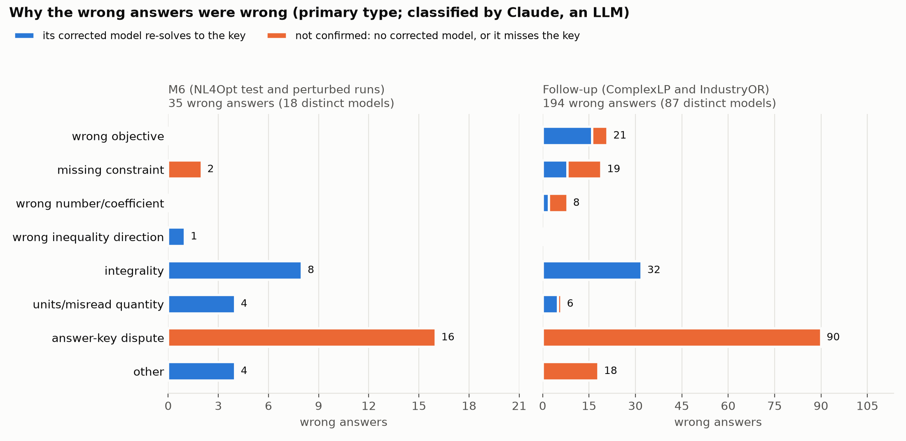

# Failure types (exploratory, post hoc)

**Status.** The taxonomy and the rules below were fixed on 2026-11-17 and committed before any
wrong answer was examined; the classification, counts and figure come after that commit (see
`git log -- docs/analysis/failure_types.md`). Neither study pre-registered this analysis, so
everything in it is exploratory and post hoc. The results of record are in `results/eval.json`
and `results/followup.json`.

**Who classifies.** Claude (an LLM: Claude Opus 5.5, in Claude Code), not a person. No label is
checked by the owner. A label is an LLM's reading of the text, the model and the key, checked
by re-solving where possible (rule 3).

M6 also has its own pre-registered taxonomy (`src/opt_agent/taxonomy.py`; labels by two LLM
judges, `review/taxonomy/test/`), for its main test run only. This is a different list, the
owner's, applied to both studies. It's classified without reading those labels, which are
compared with it afterwards.

## What is classified

- **M6** (NL4Opt): every wrong answer of the two solver conditions, single-shot and
  self-correction, in the test run (`runs/test`) and the perturbed run (`runs/test-perturbed`),
  scored as in the result of record (strict accuracy, scorable problems).
- **The follow-up** (ComplexLP and IndustryOR): every wrong answer of the three solver
  conditions, single-shot, self-correction and checklist revision, in every sample, on all 128
  problems (the 7 exposed ones marked), scored against the raw keys as in
  `runs/followup-test/followup_report.json`'s failure counts.
- **The checklist's 8 right-to-wrong revisions**, labeled by the error the revision added to a
  model that was right.
- Not the baseline: it writes no model, so there's no model error to name.

A wrong answer is **loud** (no answer) or **silent** (an answer, but not the key's).

## The types

| Type | The model's error |
|---|---|
| wrong objective | It optimizes the wrong quantity or in the wrong sense: maximize for minimize, revenue for profit, or a whole term left out or added. |
| missing constraint | A requirement the text states has no constraint or bound in the model. |
| wrong number/coefficient | The structure is right, but a number from the text's data is wrong: a different value, a value on the wrong variable or constraint, or a wrong sum or product. |
| wrong inequality direction | `<=` for `>=` or the reverse, or an inequality for an equation or the reverse, where no accepted reading allows it. |
| integrality | Integer variables where the key's answer needs continuous ones, or the reverse. |
| units/misread quantity | A statement of the text read wrongly: a unit (minutes for hours), a percentage, a rate for a total, a ratio or comparison built backwards, or a limit applied to the wrong set of things (one combined limit read as one per item, or the reverse). |
| answer-key dispute | No error is found in the model: it's a defensible reading of the text, and the key is wrong or rests on another defensible reading. Needs a stated reason. |
| other | Anything else, with a named sub-label: **no usable model** (a loud failure without a model), **extra constraint** (a requirement the text doesn't state), **wrong variables** (a decision missing or modeled wrongly), or something new, named. |

## Rules

1. **One primary type per wrong answer**, plus any secondary ones. If fixing one error alone
   gives the key's answer, that error is primary; otherwise the primary is the first of the
   model's errors in the table's order. Answer-key dispute applies only when no model error is
   found.
2. **Evidence.** M6's key comes with a reference model (built from NL4Opt's annotations), so a
   model is compared with it. The follow-up's keys are numbers only, so a model is compared with
   the text.
3. **Re-solving.** For each silent failure the classifier writes a corrected model: the model
   with the labeled errors fixed and nothing else changed. Both solvers solve it.
   **Confirmed** means its answer is right under the study's own scoring; **unconfirmed** means
   it isn't, and the label stands, marked. A corrected model comes from the text, never from
   fitting the key. For a dispute, the note says which reading the model followed and what the
   key would need. A loud failure without a model has nothing to re-solve.
4. **One label per distinct model.** Answers to the same problem with the same model (for
   example, single-shot's and self-correction's when self-correction didn't revise) share a
   label, and the counts count answers.
5. **No problem text is quoted** (it's licensed data, `DATA_NOTICE.md`). Each example says what
   went wrong in the classifier's own words, by problem ID.
6. **The list is fixed.** No type is added, merged or split once classifying starts. A case that
   fits none is "other", with a named sub-label.

<!-- results: written by `python scripts/failure_types.py build` -->

## Results

Classified by Claude (an LLM), not a person. 229 wrong answers (105 distinct models on 53 problems); per-answer rows in [`failure_types.csv`](failure_types.csv), counts in [`failure_types.json`](failure_types.json), corrected models in [`fixes/`](fixes/).

| Primary type | M6 answers | M6 share | Follow-up answers | Follow-up share | Follow-up models | Found at all (follow-up) |
|---|---:|---:|---:|---:|---:|---:|
| wrong objective | 0 | 0% | 21 | 11% | 14 | 22 |
| missing constraint | 2 | 6% | 19 | 10% | 9 | 20 |
| wrong number/coefficient | 0 | 0% | 8 | 4% | 5 | 12 |
| wrong inequality direction | 1 | 3% | 0 | 0% | 0 | 0 |
| integrality | 8 | 23% | 32 | 16% | 12 | 32 |
| units/misread quantity | 4 | 11% | 6 | 3% | 4 | 6 |
| answer-key dispute | 16 | 46% | 90 | 46% | 37 | 90 |
| other | 4 | 11% | 18 | 9% | 6 | 29 |
| **all** | 35 | | 194 | | 87 | |

"Found at all" counts answers whose model has the error as its primary or a secondary type.

**Re-solving.** 41 of 58 corrected models re-solve to the key (41 on their first check); the rest stay unconfirmed (`confirmed` = no in the CSV). Answer-key disputes and loud failures have no corrected model. 76 checks were run in all. 8 corrected models restate a whole instance (over 100 KB, IndustryOR's non-commercial data), so they aren't committed (`fix_committed` = no); their verdicts are.

**By condition** (wrong answers by primary type):

| Run and condition | wrong objective | missing constraint | wrong number/coefficient | wrong inequality direction | integrality | units/misread quantity | answer-key dispute | other |
|---|---:|---:|---:|---:|---:|---:|---:|---:|
| test single-shot | 0 | 1 | 0 | 0 | 2 | 1 | 5 | 1 |
| test self-correction | 0 | 1 | 0 | 0 | 2 | 1 | 5 | 1 |
| test-perturbed single-shot | 0 | 0 | 0 | 1 | 2 | 1 | 3 | 1 |
| test-perturbed self-correction | 0 | 0 | 0 | 0 | 2 | 1 | 3 | 1 |
| followup-test single-shot | 5 | 7 | 3 | 0 | 12 | 2 | 29 | 8 |
| followup-test self-correction | 5 | 7 | 3 | 0 | 12 | 2 | 32 | 4 |
| followup-test checklist-revision | 11 | 5 | 2 | 0 | 8 | 2 | 29 | 6 |

**"Other", by sub-label:** M6: extra constraint 4; Follow-up: instance truncated 8, no usable model 8, wrong variables 2.

**The checklist's 8 right-to-wrong revisions**, by the error the revision added: wrong objective 5, missing constraint 1, wrong number/coefficient 1, units/misread quantity 1.

**Against M6's pre-registered labels** (two LLM judges, main test run only; their categories mapped onto these types): the primary types agree on 8 of 10 failures.

<!-- end of results -->

## One example per type

Each is one distinct model, by problem ID, in the classifier's words (no problem text is quoted).

| Type | Example | Re-solved to the key |
|---|---|---|
| wrong objective | `complexlp:105`: it maximizes all water leaving the source reservoir, counting water that flows back into it, instead of the net flow reaching the sink. | yes |
| missing constraint | `complexlp:125`: no flow balance at the intermediate cities, so they ship cargo they never received. | yes |
| wrong number/coefficient | `complexlp:183`: each usage cap is the bare stock, without the small over-use the text allows (a right-to-wrong checklist revision). | yes |
| wrong inequality direction | `-864701644` (perturbed): two at-most capacity limits are written as equations, which makes the model infeasible. | yes |
| integrality | `complexlp:16`: servings of each food are continuous; the key is the cheapest plan in whole servings. | yes |
| units/misread quantity | `181608358`: a cap on one vehicle type's share is applied to the share of kilograms moved instead of the share of vehicles. | yes |
| answer-key dispute | `complexlp:63`: the model's 127 is the cheapest single tour of four cities; the key is two separate two-city round trips, which the text rules out. | no fix (a dispute) |
| other | `1344881875`: a preference the text states as a wish (more tomatoes than potatoes) is imposed as a hard constraint (sub-label: extra constraint). | yes |

## Reading the results

- **Nearly half of the wrong answers are answer-key disputes**: in each, the classifier found no
  error in the model. In the follow-up they're 90 answers on 13 problems, and 43 of them come
  from five routing problems (`complexlp:63`, `78`, `81`, `83`, `94`) whose key is two separate
  round trips, what a model without subtour elimination finds. Others: keys that are the
  continuous optimum of a problem in countable units (`industryor:28`, `41`), a key 1000 times
  the model's answer from another reading of the units (`industryor:27`), a text that states no
  objective (`industryor:24`). In M6 the 16 answers are 8 problem-runs: integer-sensitive
  problems the integrality rule labeled continuous (the known bug,
  `docs/amendments/DEVIATIONS.md`, section 3), annotated operators that contradict the
  wording, and one perturbed problem whose new numbers make the text's full-investment reading
  infeasible.
- **These are an LLM's readings, not verified keys.** The follow-up's pre-registered key-dispute
  check (5b) wasn't performed (`docs/followup/DEVIATIONS.md`, deviation 2), so the raw keys stay
  the result of record, and nothing here changes a reported accuracy. Where a dispute's
  arithmetic is plain (the routing keys, where the one-tour optimum and the two round trips can
  be added up by hand), it was checked that way; the rest rest on the classifier's reading.
- **Of the model errors, integrality is the most common** (mostly diet problems solved with
  fractional servings), then wrong objective (in the follow-up, mostly max-flow objectives that
  count flow leaving the source, including flow that comes back) and missing constraint.
  "Other" is mostly loud failures with no usable model and one routing problem
  (`industryor:31`) where every model covered 3 of the 100 customers ("instance truncated").
- **The checklist's right-to-wrong revisions mostly replaced a right objective**: following an
  objective flag, the revision switched a max-flow model to counting every unit leaving the
  source.
- **Judgment calls that move counts.** Integrality follows the owner's M6 criteria (countable
  things are whole numbers): that makes the fractional-servings models integrality errors and
  the 7 answers on `industryor:28` and `41`, where the key is the continuous optimum, disputes.
  Rule 1 puts a model with a harmless error and a disputed key under its error (`complexlp:78`
  model `1ec8d22b67` and M6's `431521997`, 4 answers), and the classifiers noted a few
  near-ties between types; the CSV's notes say which.
- **Against the M6 judges** (main test run): the two disagreements are `181608358` (their
  coefficient, here units/misread quantity) and `431521997` (their reference error, here missing
  constraint, by rule 1 above).
- **How it was done:** `scripts/failure_cases.py` replays every wrong answer in its study's tag
  tree to get the model behind it; five Claude subagents each classified a batch from one
  instruction sheet, writing a corrected model per silent failure; `scripts/failure_types.py
  check` re-solved each one (every check logged), and `build` re-solves them all again and
  writes the CSV, the counts and the figure. Corrected models that restate a whole instance
  (over 100 KB) aren't committed; `tests/test_failure_types.py` re-solves the committed ones
  and checks that every wrong answer in the results files is classified exactly once.
